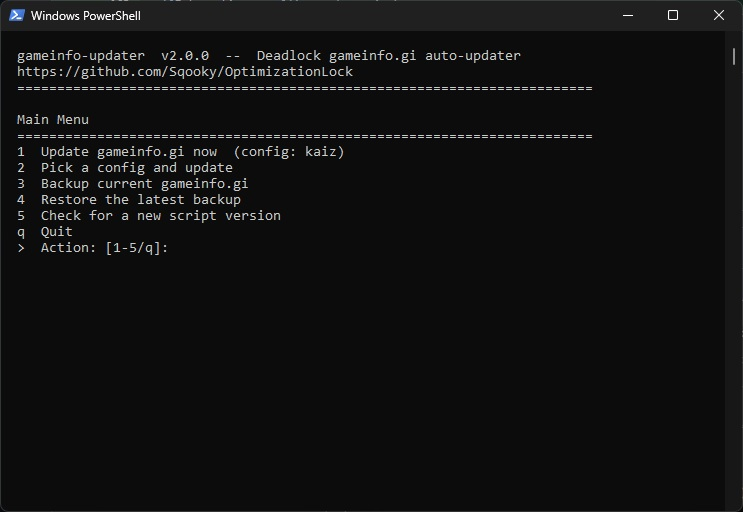

# gameinfo-updater

I got annoyed with having to manually patch the file each time it updated, so heres a script to auto-update and apply overrides

**What it does automatically:**
- installs any config from this repo straight from GitHub, so you always get the latest patch
- re-applies your personal convar locks from an `overrides.gi` file on top of every fresh config
- shows what changed upstream and can print a full diff before writing anything
- creates a timestamped backup before every write, with one-command rollback
- remembers the config you picked and offers to update itself every 15 days
- runs with no arguments: an interactive menu — just press a number



## The interactive menu

Run the script with no arguments and it opens a menu instead of an error:

```
Main Menu
========================================================================
1  Update gameinfo.gi now  (config: kaiz)
2  Pick a config and update
3  Backup current gameinfo.gi
4  Restore the latest backup
5  Check for a new script version
q  Quit
```

- **Pick an action by pressing its number** — no commands to memorize.
- **The screen is cleared between pages** (and on startup), so you only ever see the current screen; after an action finishes the script waits for Enter before returning to the menu, so you never lose its output.
- **Config picker** (action 2) shows all available configs as a numbered list and marks the saved one.
- **Remembered config** — when you pick a config, the script offers to remember it as the default (stored in `updater_config.json`); later runs use it automatically, and the menu shows it next to action 1. If the saved name is ever invalid, the script tells you and offers to erase it.
- **Self-update** — at most once every 15 days the script offers to check GitHub for a newer version of itself and can install it in place (keeping a `.bak` of the old one). While the check is overdue, the menu points it out right on line 5.
- **Colored output** — status tags `[+] / [!] / [x]`, section headers and a version banner. Colors turn off automatically when the output is piped somewhere.

## Quick start (PowerShell — Windows, nothing to install)

1. Copy `auto updater/` somewhere convenient (Desktop, Documents, etc.).
2. Rename `overrides.example.gi` → `overrides.gi` and edit it to your preferences (or skip — the script works without it).
3. Run:
```powershell
powershell -NoProfile -ExecutionPolicy Bypass -File "gameinfo_updater.ps1"
```
4. Press 1.

Script will try to auto-detect gameinfo.gi location if not specified, and will use the overrides.gi file in the same directory as the script if not specified. Everything is driven through the menu — no flags needed.

## Quick start (Python 3.8+)

1. Copy `auto updater/` somewhere convenient (Desktop, Documents, etc.).
2. Rename `overrides.example.gi` → `overrides.gi` and edit it to your preferences.
3. Run `python gameinfo_updater.py update`

---

## Commands

### `update` — fetch from github repo and apply

```
python gameinfo_updater.py update [options]
```

| Option | Description |
|--------|-------------|
| `--config NAME` | Config shortcut (default: `sqooky`). See `list-configs`. |
| `--url URL` | Direct GitHub URL (blob or raw) to any `gameinfo.gi` in the repo, on any branch or commit. |
| `--overrides PATH` | Overrides file. Default: `overrides.gi` next to this script. |
| `--gameinfo PATH` | Target `gameinfo.gi`. Auto-detected from Steam if omitted. |
| `--dry-run` | Print the override summary (and diff, if `--diff`) without writing anything. |
| `--diff` | Print a unified diff of the current file vs. the new one. |
| `--no-backup` | Skip creating a timestamped backup before writing. |

Only one of `--config`, `--url` may be used at a time.

**Examples:**

```powershell
# Default: Sqooky's config, auto-detect gameinfo, use overrides.gi
python gameinfo_updater.py update

# Boot's max-FPS config, preview only, don't write
python gameinfo_updater.py update --config boot --dry-run

# Specify every path explicitly
python gameinfo_updater.py update `
  --config sqooky `
  --overrides "C:\Users\User\my-overrides.gi" `
  --gameinfo "C:\Program Files (x86)\Steam\steamapps\common\Deadlock\game\citadel\gameinfo.gi"

# Use a direct GitHub URL (any branch, any commit)
python gameinfo_updater.py update `
  --url "https://github.com/Sqooky/OptimizationLock/blob/main/test_cfg/gameinfo.gi"

# Preview the exact line-by-line diff before writing
python gameinfo_updater.py update --config sqooky --dry-run --diff
```

---

### `list-configs` — view available config shortcuts

```powershell
python gameinfo_updater.py list-configs
```

Output:

```
Available configs (use with --config <name>):

  
    sqooky            Sqooky's OptimizationLock (recommended)
    performance       Sqooky's Max FPS config (best performance)
    boot              Boot's Maximum FPS
    kaiz              Kaizuchaneru's Minimum Spec
    piggy             Piggy's Config
    eskay             Eskay's modified fork of Sqooky's
    clean             Clean / Near-Vanilla
```

---

### `restore` — roll back to a backup

```powershell
# Restore the most recent automatic backup
python gameinfo_updater.py restore --latest

# Restore a specific backup file
python gameinfo_updater.py restore --backup gameinfo.20250625_143000.bak
```

Backup files are named `gameinfo.YYYYMMDD_HHMMSS.bak` and stored next to `gameinfo.gi`.
The `restore` command also creates a new backup of the *current* file before overwriting,
so you can always undo the restore.

---

### `backup` — snapshot the current file

```powershell
python gameinfo_updater.py backup
```

Useful before editing the file manually.

---

## Overrides file format

Copy `overrides.example.gi` to `overrides.gi` (or any name you like) and edit it.

```text
# Lines starting with # are ignored.

# Lock a convar to a specific value (uncomments it if commented upstream):
fps_max 144
panorama_max_fps 60

# Force a convar to be commented out:
// r_farz
// r_mapextents
```

---

## Extra info

- A timestamped backup is created automatically before every write unless you pass `--no-backup`.
- Use `--dry-run` to preview the full unified diff before committing.

---

## Auto-detection paths

| Platform | Paths checked |
|----------|---------------|
| Windows | `C:\Program Files (x86)\Steam\...` |
| | `C:\Program Files\Steam\...` |
| | `%STEAM_PATH%\...` |
| Linux | `~/.steam/steam/...` |
| | `~/.local/share/Steam/...` |
| | `~/.var/app/com.valvesoftware.Steam/...` |

Use `--gameinfo <path>` to override auto-detection for custom Steam locations.
